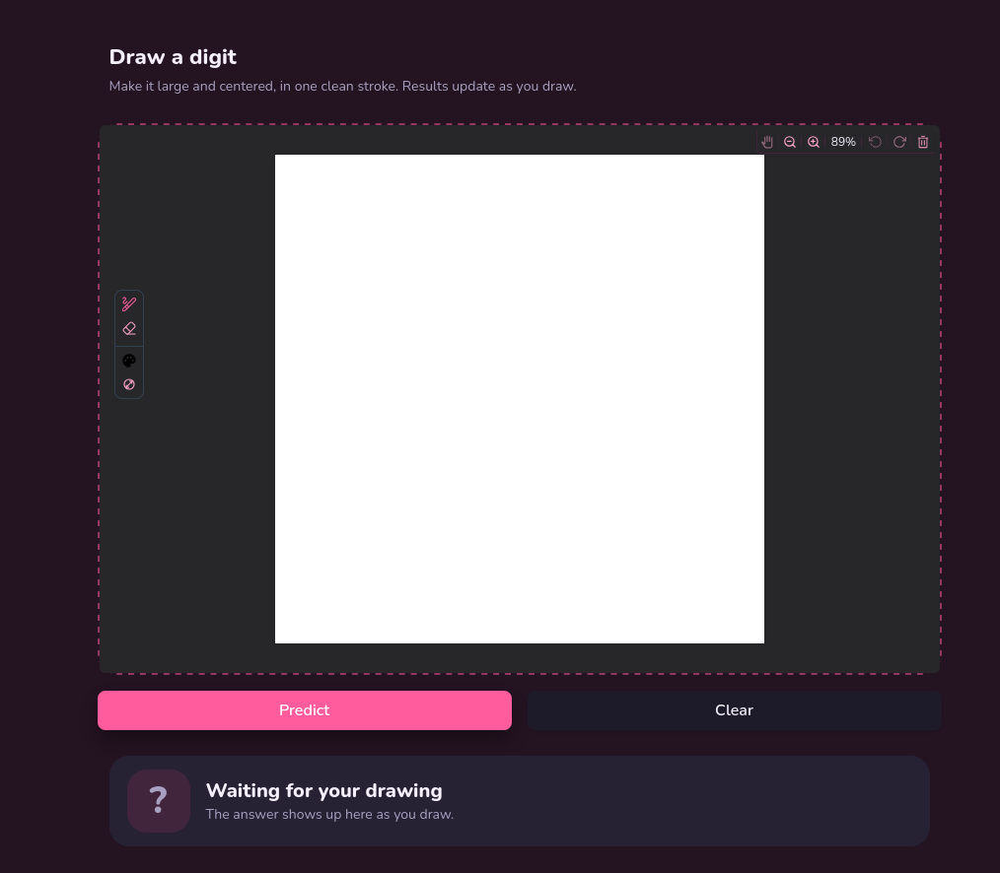
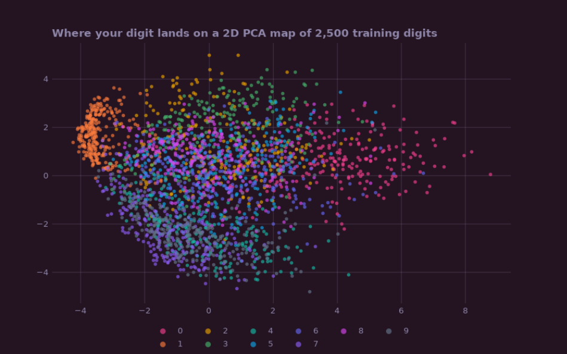
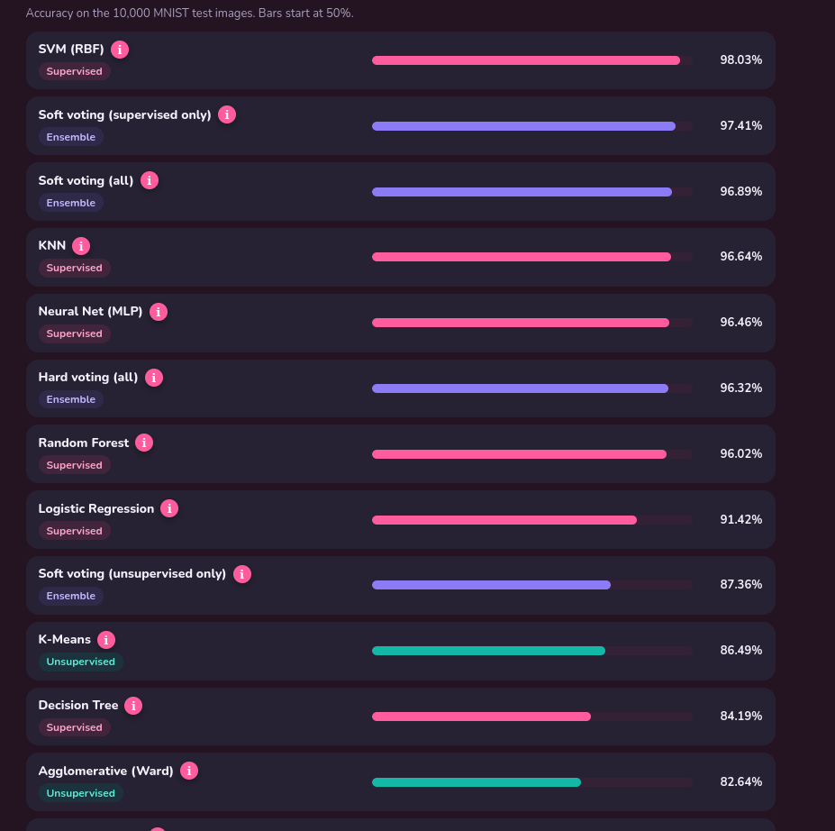

# NumNum_Whoisthere

Handwritten digit recognition (MNIST) with supervised **and** unsupervised voters, served through a Gradio web interface.


## Problem

Recognizing handwritten digits (0–9) from 28×28 grayscale images is a classic computer vision challenge. This project explores both **supervised learning** (models trained directly with digit labels) and **unsupervised learning** (models that discover pixel clusters before any labels are assigned), then combines them through hard and soft voting ensembles.

## Technology


## Authors

- Nader Sherif
- Ahmed Badr
- Hamza Sayed

## Main Block

The core of NumNum_Whoisthere is a collection of digit classifiers working together through a Gradio interface. Users draw a digit on the canvas, and every selected model casts a vote. The final prediction comes from the chosen voting strategy.

### Models by category

| Category | Models |
|----------|--------|
| **Supervised** | Logistic Regression, KNN, SVM (RBF), Decision Tree, Random Forest, Neural Net (MLP) |
| **Unsupervised** | K-Means, Gaussian Mixture, Agglomerative (Ward) |
| **Ensembles** | Hard voting (all), Soft voting (all), Soft voting (supervised only), Soft voting (unsupervised only) |

### Key features

- Draw a digit on an interactive canvas and get real-time predictions
- Per-model predictions with confidence scores
- Supervised vs. unsupervised model tags on every result
- Multiple voting strategies: hard/soft, all/supervised-only/unsupervised-only
- Palette switcher and light/dark theme toggle
- About dialog explaining each algorithm step by step



## Compare

NumNum_Whoisthere contrasts supervised and unsupervised approaches to digit recognition, and compares individual models against voting ensembles.

### Supervised vs. unsupervised vs. ensembles

| Aspect | Supervised models | Unsupervised models | Voting ensembles |
|--------|-------------------|---------------------|------------------|
| Uses digit labels during training | Yes | No | Aggregates both |
| Discovery basis | Labeled examples | Pixel clusters only | Combined predictions |
| Output | Digit + probability | Digit + probability | Consensus digit |
| Example models | Logistic Regression, Random Forest, MLP | K-Means, Gaussian Mixture, Agglomerative | Hard / Soft voting |

### Individual models vs. ensembles

| Approach | Behavior |
|----------|----------|
| Single model | One model's decision on the drawing |
| Hard voting | Each model votes for its top digit; majority wins |
| Soft voting (all) | Probabilities averaged across all models; highest average wins |
| Soft voting (supervised only) | Probabilities averaged across supervised models only |
| Soft voting (unsupervised only) | Probabilities averaged across unsupervised models only |

The unsupervised models discover structure from pixels alone (no labels), then name each cluster after the most common digit inside it — offering a complementary signal to supervised learners.



## Leaderboard

Models are evaluated on the MNIST test set (10,000 held-out images). Each model's accuracy is the fraction of test drawings it classifies correctly. Results are computed at runtime and cached in `mnist_models_v3.joblib`.

| Rank | Model | Type | Accuracy |
|------|-------|------|----------|
| — | Logistic Regression | Supervised | Evaluated at runtime |
| — | KNN | Supervised | Evaluated at runtime |
| — | SVM (RBF) | Supervised | Evaluated at runtime |
| — | Decision Tree | Supervised | Evaluated at runtime |
| — | Random Forest | Supervised | Evaluated at runtime |
| — | Neural Net (MLP) | Supervised | Evaluated at runtime |
| — | K-Means | Unsupervised | Evaluated at runtime |
| — | Gaussian Mixture | Unsupervised | Evaluated at runtime |
| — | Agglomerative (Ward) | Unsupervised | Evaluated at runtime |
| — | Hard voting (all) | Ensemble | Evaluated at runtime |
| — | Soft voting (all) | Ensemble | Evaluated at runtime |
| — | Soft voting (supervised only) | Ensemble | Evaluated at runtime |
| — | Soft voting (unsupervised only) | Ensemble | Evaluated at runtime |

### Evaluation methodology

- **Dataset:** MNIST — 60,000 training / 10,000 test images
- **Training subset:** `N_TRAIN` images (default 20,000)
- **Metric:** Classification accuracy on the held-out test set
- **Caching:** Trained models and accuracy are cached in `mnist_models_v3.joblib`

No precomputed leaderboard scores are stored in the repository; run the app to generate results for your environment.



## Run

```bash
pip install gradio scikit-learn pandas pillow numpy scipy joblib matplotlib
python main.py
```

Then open http://127.0.0.1:7860

First run downloads MNIST (~15 MB) and trains the models (a few minutes). Everything is cached in `mnist_models_v3.joblib`.

Optional environment variables:

- `MNIST_LOCAL_DIR` — folder with the 4 MNIST `.gz` files (offline use)
- `N_TRAIN` — number of training images (default 20000)
